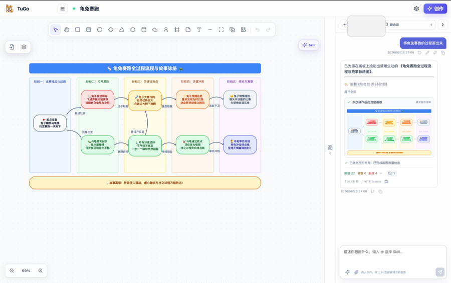
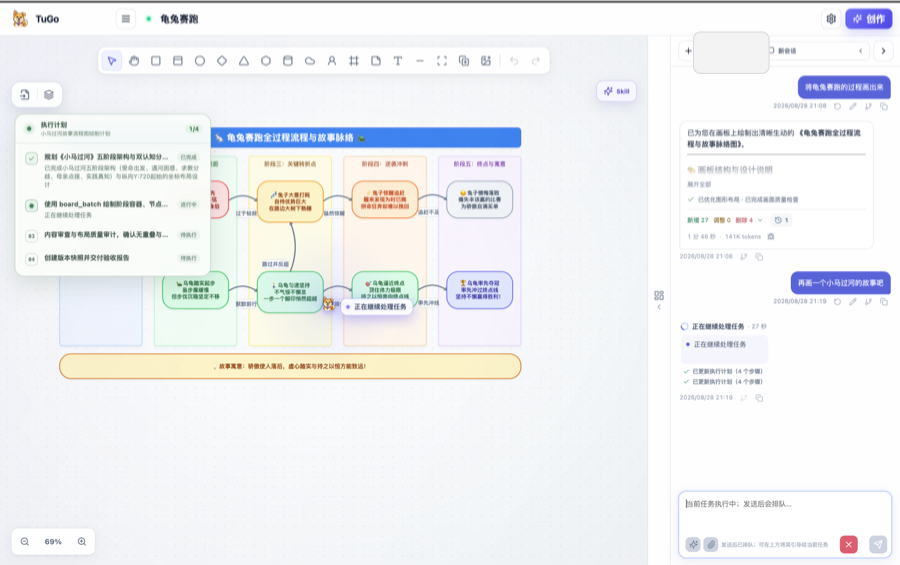
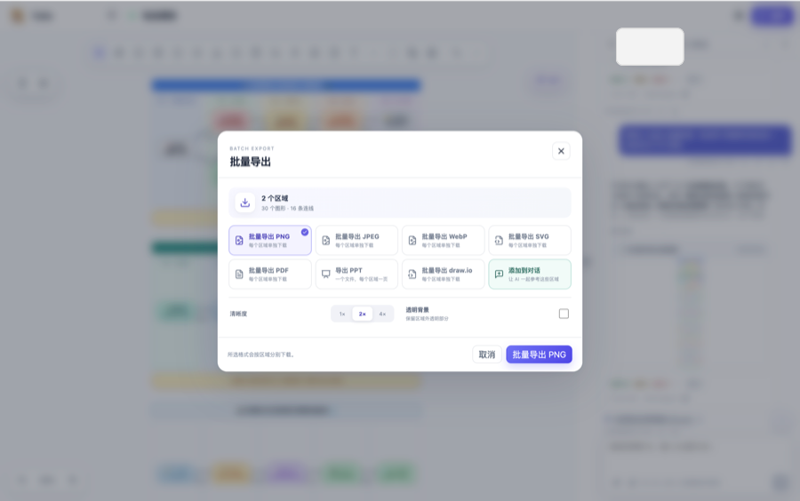
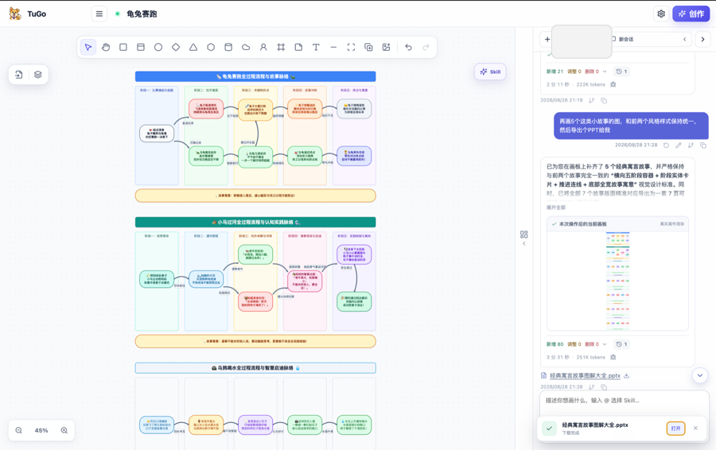
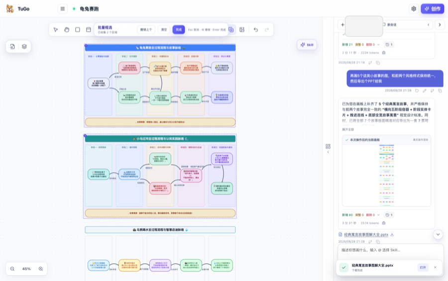
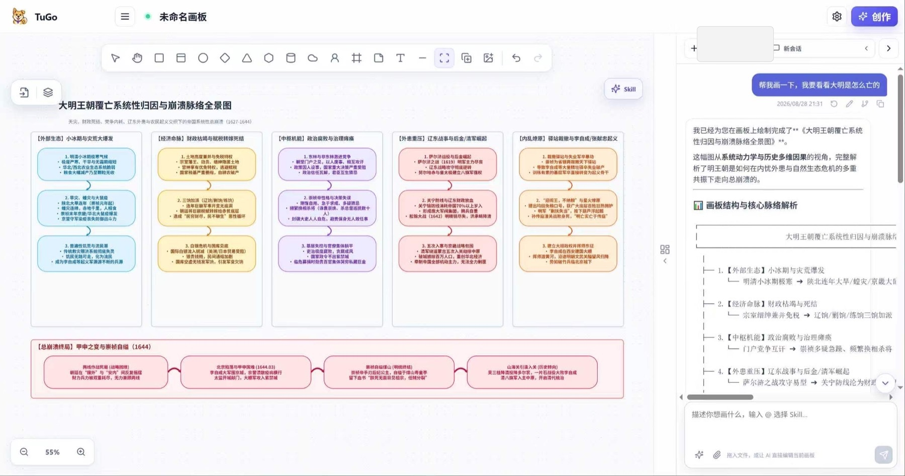
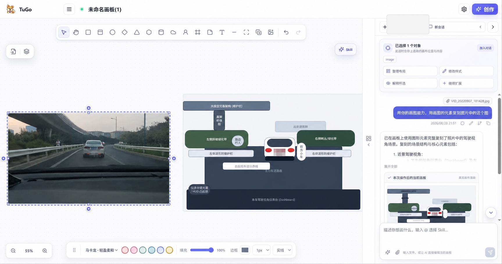

<p align="center"></p>

<h1 align="center">TuGo · 图狗</h1>

<p align="center"><strong>An AI-native canvas for diagrams you can keep editing and turn into slides.</strong></p>

<p align="center">A local-first infinite canvas where AI creates and revises diagrams beside you. Select a region as context, keep editing directly, then export deliverable PowerPoint slides.</p>

<p align="center">
  <a href="README.md"></a>
  <a href="README.en.md"></a>
</p>

<p align="center"><a href="docs/en/GETTING_STARTED.md">Getting started</a> · <a href="docs/en/CANVAS_AND_EXPORT.md">Canvas and PowerPoint workflow</a> · <a href="docs/en/README.md">Documentation</a></p>



## Why TuGo

TuGo is not a text-to-image generator with a canvas bolted on, and it is not just a drawing app with a chat panel. AI and the user work on the same directly editable board: refine it by hand, select the part that matters for the next request, then turn regions of the board into a presentation that can keep moving through a real workflow.

| What stays yours | How TuGo does it |
| --- | --- |
| A diagram you can keep working on | AI creates shapes, text, and connectors on the board. Move, edit, group, and reorganize them yourself. |
| Explicit visual context | Select one or more regions and add them to chat so the next AI request has a concrete part of the board to reference. |
| A deliverable, not a dead end | Export selected regions as PNG, SVG, PDF, draw.io, or PPTX. Batch selection makes one PowerPoint slide per region. |

## From prompt to delivery

### 1. Start on the canvas with AI

Give TuGo a question or task. AI can create flowcharts, architecture diagrams, mind maps, and visual explanations for complex subjects. The run shows its plan and progress, and the result remains a board you control.



### 2. Select what you want to continue discussing

Batch-select one or more board regions. Export them, or choose **Add to chat** to make them explicit references for the next AI request instead of re-explaining the whole diagram.



### 3. Carry the canvas into a real deliverable

Select several regions in slide order and export a PPTX. Supported shapes, text, and connectors are written as PowerPoint objects. Review fonts, clipping, layout, and factual content before delivery.



## Core capabilities

- **Infinite canvas, direct editing** — shapes, notes, text, images, connectors, grouping, pan/zoom, undo and redo.
- **AI diagram collaboration** — bring your own model provider to create, revise, and organize flowcharts, architecture diagrams, and mind maps.
- **Region-as-context** — add one or more selected regions to chat so AI can focus on the relevant part; references express intent, not a hard editing boundary.
- **Batch export to a deck** — select regions in order to make a multi-slide PPTX; PNG, JPEG, WebP, SVG, PDF, and draw.io are also available.
- **Import, project, and extend** — Mermaid plus compatible subsets of PlantUML and draw.io XML; local projects, folders, conversations, autosave, snapshots, Skills, and external MCP tools.



The canvas is not limited to technical diagrams. This is an editable causal map generated from a question about the fall of the Ming dynasty. It is a real product result, not a substitute for fact-checking history.



## Recreate a reference image as an editable diagram

When the selected model **supports vision input**, attach a flowchart screenshot, whiteboard photo, or scene reference and ask AI to redraw its structure with canvas elements. This is not simply embedding the source image: the goal is editable shapes, text, and connectors that you can move, revise, and export.



First confirm vision support in **Settings → Models**, then attach the image in chat. Placing an image on the canvas alone does not make it model input. Try: `Use the attached image as reference. Redraw its main structure on the current board with editable nodes and connectors. Mark anything unreadable as “Needs confirmation”; do not guess.`

Remove or obscure license plates, faces, IDs, addresses, and confidential information before uploading. See [Canvas, images and PowerPoint](docs/en/CANVAS_AND_EXPORT.md#images) for the detailed workflow.

## Quick start

Download the installer matching your platform and architecture from this repository's **Releases** page. If no installer is published, run TuGo from source; GitHub's Source code ZIP is not an installer.

The initial desktop target is macOS 13+ on Apple Silicon. Windows x64 packaging exists in source; verify real-device validation and signing in each release's notes. Intel Mac and Linux desktop support are not promised.

1. Open **Settings → Models**, add a model provider, model ID, endpoint, and API key, then test and save it.
2. Create a board and ask: `Draw an order-processing flow with payment, stock checks, shipping, and refund branches.`
3. Use **region export** to select content, then choose **Add to chat** or an export format.
4. For a multi-slide deck, use **batch selection**, draw regions in slide order, then choose **Export PPT**.

Read [Getting started](docs/en/GETTING_STARTED.md) and [Canvas and PowerPoint workflow](docs/en/CANVAS_AND_EXPORT.md) for the full workflow.

## Local-first and model-provider choice

Boards, conversations, and attachments are stored locally. You configure the model service, model ID, and API key. Calls to external models, Web, or MCP tools may send relevant prompts, conversations, board content, or attachments to those services. **Local-first does not mean data can never leave your device.**

TuGo includes neither model credits nor a bundled offline language model. Read [Privacy](PRIVACY.md) and [Backup and recovery](docs/en/DATA_RECOVERY.md), and always review AI-generated facts, layout, and exports.

## Run from source

Use Node.js `25.2.1` and npm `11.6.2` (see `.nvmrc` and `package.json`):

```bash
npm ci
npm run dev
```

`npm run dev:web` previews only the renderer; it does not provide Electron's local databases, attachment access, or Agent Runtime. Installed builds do not need a separate Node.js or Python installation.

## Documentation, contribution, and license

- [English documentation](docs/en/README.md) · [中文文档](docs/README.md)
- [Development](docs/DEVELOPMENT.md) · [Packaging](release-docs/PACKAGING.md) · [Release checklist](docs/RELEASING.md) · [Changelog](CHANGELOG.md)
- [Contributing](CONTRIBUTING.md) · [Support](SUPPORT.md) · [Security](SECURITY.md) · [Known limitations](release-docs/KNOWN_LIMITATIONS.md)

**TuGo 1.0.0 is its first public release.** It is licensed under [Apache License 2.0](LICENSE). See [NOTICE](NOTICE) and [third-party notices](THIRD_PARTY_NOTICES.md) for attribution and dependency licenses.
