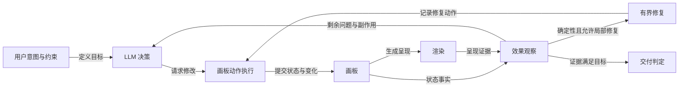
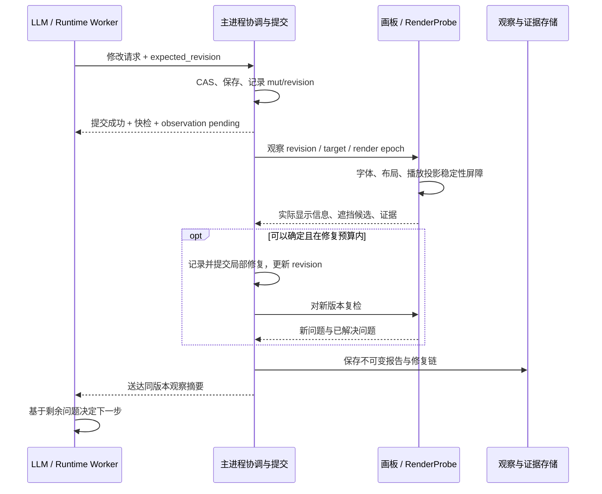

# TuGo ReAct 观察与有界自动修复方案

状态：方案草案，尚未实现本文新增机制。日期：2026-10-27。

## 1. 目标与核心决策

让 LLM 观察到“操作后实际发生了什么”，而不只看到工具是否执行成功。观察应包含预期变化、自动调整、间接影响、未解决问题、证据范围及不确定性。

采用一套独立的**画板观察机制**，服务于 UI、LLM 工具和 CLI。它不要求每次编辑都完整走一遍制图 SOP，而是在需要决策的位置提供可信反馈。

关键决策：

1. 命令结果与效果观察分离。保存成功不能代表画面正确；观察失败也不能反向宣称操作未发生。
2. 观察同时绑定画板状态、渲染环境和目标。相同数据在旧版与修复版渲染不同，不能复用“数据 hash 相同”的通过结论。
3. 工具负责可确定、受约束的局部修复；LLM 负责语义、结构和取舍。不能靠反复提示 LLM 调坐标兜底。
4. 每次观察必须明确通过、失败、未检查、失效及检查范围。没有证据不能填“通过”。
5. 自动修复是新的有副作用操作，必须记录、可撤销、可复检，不能藏在只读观察工具里。
6. 最终验收读取可信观察记录，不能让 LLM 自己提交一个 `visual_review.status=passed` 充当证据。

## 2. 当前事实与缺口

| 当前事实 | 缺口与影响 |
| --- | --- |
| [App.tsx](/Users/fuhongyuan/TuGo/src/App.tsx:2262) 保存画板后调用 `reflectDiagram`，工具结果带少量 `layout_feedback` | 是几何推导，不是实际画面检查；缺少副作用差量、证据覆盖和渲染版本；截断报告也可能让模型忽略其余问题 |
| [InfiniteCanvas.tsx](/Users/fuhongyuan/TuGo/src/components/InfiniteCanvas.tsx) 存在 AI 播放投影、实时 DOM 排版和实际 SVG 路径 | 已持久化状态、动画中画面及稳定画面可能不同；数据保存与“观察时机”之间没有明确屏障 |
| [exportDocument.ts](/Users/fuhongyuan/TuGo/src/lib/exportDocument.ts:98) 的 `renderRegionPngDataUrl` 通过 SVG 导出生成 PNG | `board_capture_image` 不能直接证明当前画板 DOM、播放投影或编辑层没有问题；也不能证明 WPS/PowerPoint 打开的 PPT 正常 |
| [runtime.ts](/Users/fuhongyuan/TuGo/runtime-ts/src/runtime.ts:610) 将工具结果直接加入模型消息，并有审计次数上限 | 缺少独立观察调度与版本失效规则；“停止审计”不应变成“验收通过” |
| [tools.ts](/Users/fuhongyuan/TuGo/runtime-ts/src/tools.ts:330) 与 [diagramQualityContracts.ts](/Users/fuhongyuan/TuGo/runtime-ts/src/diagramQualityContracts.ts:136) 接收模型传入的布局/视觉报告 | 还未通过观察 ID 校验证据所属画板、版本、目标和覆盖范围 |
| [cliCommands.ts](/Users/fuhongyuan/TuGo/src/lib/cliCommands.ts:25) 的 revision 是部分画板字段的内容 hash | 不能代表渲染器版本、字体、展示目标，也不能独自解决撤销后内容相同、异步结果晚到的问题 |

已有 [质量 SOP 计划](/Users/fuhongyuan/TuGo/docs/DIAGRAM_QUALITY_SOP_PLAN.md) 强调页面算法优先、避免固化全流程。本文延续此原则，补足运行时观察与证据契约；旧文档中的“已完成”描述不替代当前版本的实测证据。

## 3. 概念架构：谁负责什么



| 概念 | 职责 | 不承担的职责 |
| --- | --- | --- |
| 动作执行 | 原子修改、并发检查、版本生成、操作回执与撤销记录 | 宣称视觉成功 |
| 渲染 | 路由、排版、图层、稳定画面和实际布局信息 | 猜测业务含义、偷偷改关系 |
| 效果观察 | 对照意图，收集状态与渲染事实，识别副作用，给出证据和局限 | 无条件修改画板 |
| 有界修复 | 在约束内解决确定性局部问题，并验证收益 | 全局重排、删减内容、改变箭头语义 |
| LLM 决策 | 判断是否调整布局、分解图、改变表达或请求缺失信息 | 把工具成功或自己的评价当成观察证据 |
| 交付判定 | 核对当前目标对应的可信证据，说明通过项与未验证项 | 用综合分数抹掉单个阻断问题 |

## 4. 观察分层：不仅是工具返回值

| 层次 | 回答的问题 | 典型检查与证据 |
| --- | --- | --- |
| 执行观察 | 操作到底有没有发生？ | 操作 ID、提交状态、前后版本、实际新增/修改/删除、持久化回执 |
| 结构观察 | 数据和约束有没有被破坏？ | 端点有效、对象数量、分组归属、锁定约束、关系与文字内容未被误改 |
| 几何观察 | 计算出来的布局是否有明显问题？ | 路径穿框、标签与文字碰撞、端点接触、通道容量、字号下降、影响范围 |
| 呈现观察 | 实际画面是否符合几何推导？ | 字体就绪、DOM 文本实际边界、clip/mask、绘制顺序、箭头显示、稳定画面裁剪图 |
| 语义/表达观察 | 图是否正确表达了用户意图？ | 对照 Brief/参考图核对实体与关系、阅读路径、信息密度；不确定关系保留不确定性 |

前三层尽量程序化。第四层结合渲染信息与图像证据：包围盒或一张截图都不能独自证明所有像素可见。第五层交给有上下文的 LLM；无视觉能力时不伪造视觉结论。

目标需要分开：`canvas_scene`（稳定画板场景）、`live_viewport`（当前可见窗口）、`svg_export`、`png_export`、`pptx_structure`、`pptx_render`。画板通过不代表 PPT 通过；仅解析 PPT XML 只能通过结构检查。没有相应 Office 渲染环境时，PPT 实际显示状态应为 `unknown`。

### 连线被遮挡如何观察

1. 从统一路由输出拿到实际路径、线宽、端点和箭头几何，不能重新用中心直线估计。
2. 在渲染层结合绘制顺序、变换、透明度、裁剪和遮罩，计算可见性候选；分组背景在其后面不算遮挡，箭头进入目标边界的正常接触也不算穿框。
3. 对可疑路段生成同版本局部图，结合像素/渲染信息验证，必要时送视觉模型；几何预测与实际画面不一致时上报差异。
4. 输出受影响边 ID、遮挡者 ID、区域、证据来源和置信度。只能证明几何相交时报告 `suspected_occlusion`，不能直接认定整条线不可见。
5. 同时检查修复影响：这条线绕开了节点，但是否增加折点、挤占另一条线的通道、遮住标题或移动标签。

## 5. 逻辑架构与状态归属

新增机制按职责拆分，但不新增独立服务进程：

| 逻辑组件 | 责任与状态 | 主要落点（提议） |
| --- | --- | --- |
| `BoardMutationGateway` | UI、LLM、CLI 的统一写入口；CAS、mutation/group ID、前后差量、来源与撤销归组 | 抽取 App 中保存/修改协作，复用现有 Electron 持久化 |
| `ObservationCoordinator` | 观察调度、合并、等待屏障、覆盖范围、取消与旧结果处理 | Electron 主进程内的协调模块 |
| `RenderProbe` | 报告实际投影版本、字体/布局/播放状态、文字及路径显示证据；只读 | `InfiniteCanvas` 与渲染进程 |
| `QualityAnalyzers` | 结构、几何、渲染和导出分析；保留完整问题集及稳定问题 ID | 扩展现有几何、排版、审计与导出模块 |
| `LocalRepairPlanner` | 提出限定 patch、解释收益和影响；执行仍走统一写入口 | 复用路由、标签、排版能力，新增预算与约束检查 |
| `ObservationStore` | 保存不可变报告、证据引用、策略版本、修复链；支持当前有效性查询 | RuntimeRepository/现有持久化边界，不另设数据库 |
| `RuntimeObservationAdapter` | 将观察带入下一轮模型上下文；执行交付前证据检查 | Runtime 工具循环与 checkpoint |

画板文档是可编辑状态的事实源；Electron 中的提交入口串行化同一画板的写入。React 场景和观测报告是派生状态。观察报告不能成为另一份可修改的画板事实源。

变更不能只返回“新增两个节点”：移动一个节点可能改变非选中连线的路由。同侧端口重排、被占用通道、裁剪区、容器和相邻标签均纳入影响传播。无法证明影响集完整时，明确标记 `coverage=partial`，交付前补全局检查。

### 统一观察契约

下面是最终观察报告示意，不是现有接口。各工具保留自己的功能结果，附加观察摘要/引用；所有报告保留完整明细，按需分页读取。

```json
{
  "observation_id": "obs_042",
  "cause": {
    "mutation_id": "mut_041",
    "group_id": "draw_group_07",
    "tool_call_id": "call_12",
    "actor": "llm"
  },
  "identity": {
    "project_id": "bound_project",
    "document_seq": 43,
    "content_hash": "hash_r43",
    "renderer_fingerprint": "build+router+text+fonts",
    "render_epoch": 19,
    "target": "canvas_scene",
    "policy_version": "quality_policy_1"
  },
  "execution": { "status": "committed", "requested_revision": 41 },
  "changes": {
    "requested_ids": ["R03", "edge_17"],
    "indirectly_affected_ids": ["edge_21", "edge_29", "label_29"]
  },
  "automatic_fixes": [
    {
      "type": "reroute_edge",
      "refs": ["edge_17"],
      "source": "deterministic_router",
      "persisted": false,
      "before": { "node_intersections": 1 },
      "after": { "node_intersections": 0 }
    }
  ],
  "side_effects": [
    { "type": "route_changed", "refs": ["edge_21"], "extra_bends": 2 }
  ],
  "checks": {
    "state": "passed",
    "geometry": "passed",
    "render": "failed",
    "reference_semantics": "not_checked"
  },
  "coverage": { "scope": "affected_region", "complete_scene": false },
  "findings": [
    {
      "id": "issue_29",
      "type": "label_occluded",
      "severity": "blocking",
      "refs": ["edge_29", "node_18"],
      "confidence": 0.98,
      "evidence_source": "render_probe+crop",
      "region": { "x": 620, "y": 280, "width": 180, "height": 90 },
      "evidence_id": "crop_29",
      "needs_llm_decision": true,
      "options": ["增加这一列间距", "将该关系移到下方通道"],
      "preserve": ["节点文字", "箭头方向", "用户锁定位置"]
    }
  ],
  "verdict": "needs_decision",
  "summary": "修改已保存；工具修好1条线，另影响3个对象。一个标签仍被遮挡。"
}
```

注意：`execution.requested_revision` 是动作开始版本，`identity.document_seq` 是修复后被检查的版本；中间每个已持久化修复必须在日志中有自己的 mutation 与版本。示例中的派生路由调整不改文档，但仍是需要观察的呈现变化。

检查状态使用 `passed / failed / unknown / not_checked / stale`；调度状态使用 `pending / running / completed / cancelled`，两者不混用。`verdict` 可为 `verified / needs_decision / partially_verified / unverified / stale`，不能只用一个 `ok`。

`project_id` 由会话注入，LLM 不能借观察工具改变目标画板。证据包含可能来自用户/文档的文字，作为数据呈现，不能提升为 Runtime 指令。

### 接口调整

- 现有写工具：返回提交回执、快速结构检查和 `observation_ref`；完整观察可能仍在进行。兼容原有 `ok`，但其含义限定为命令执行。
- 新增 `board_observe`：只读请求观察；支持目标、区域/全景、expected_revision 和等待。默认当前绑定画板，缓存只能在身份和覆盖条件都匹配时复用。
- 新增 `board_get_observation`：按 ID 读取状态、完整问题、修复链、区域证据和检查覆盖。摘要保留完整 blocking 数量，不因只展示前三项而丢失阻断信息。
- 自动修复由 Coordinator 显式调用内部 `repair_apply` 命令，输出回执；不让 `board_observe` 或 `board_review_quality` 偷偷改图。
- `board_capture_image` 保留，但返回证据 ID、目标和版本。导出生成图与 live canvas 截图明确区分。
- `diagram_acceptance_check` 改为接收观察/内容证据 ID，Runtime 从可信记录读取并核对；旧对象参数迁移期仅视为模型意见，不能获得“已验证”身份。
- CLI 的 `board apply/review/export` 使用同一 Gateway 与观察契约。LLM 的 12 项批次与 CLI 的 256 项批次上限保持独立；一次任务/逻辑阶段通过 group ID 聚合，不把“一个 CLI 批次”误称为“一个 LLM 工具调用”。

## 6. 何时观察、何时让 LLM 看见

分级触发，避免每改一个节点就截图、调用视觉模型或执行完整审计。

| 时机 | 默认行为 | 是否等待、是否交给 LLM |
| --- | --- | --- |
| 每次提交 | 快速结构检查、记录影响范围、低成本副作用差量 | 即时返回；明显阻断/意外改动立即上报 |
| 同一阶段连续小批次 | 按 mutation group 合并，维护当前版本的观察任务 | 可以继续不依赖视觉的绘图步骤，不机械中断 |
| 一组节点与连线已成形、布局动作结束 | 运行区域几何与渲染检查 | 下一轮布局决策前优先提供结果 |
| 新增密集关系、字体明显变小、替换容器/层级、自动修复后 | 提升观察级别，检查受影响连线和文字 | 在继续相关调整前等待有限时间；失败/不确定升级给 LLM |
| LLM 主动要求核对或用户说“看一下效果” | 调用 `board_observe`，按需生成局部证据 | 等待当前目标证据，不能只返回旧报告 |
| 准备导出 | 先确认文档稳定，再对实际导出产物建立独立观察 | 画板报告不能替代导出报告 |
| 准备声称完成 | 检查当前 revision 的最终全景/目标证据 | 未完成、过期、预算耗尽都不能变成通过；可交付明确标注的部分结果 |

200–400ms 的变更合并窗口、单次等待上限和 Token/图像预算作为初始配置，需用实测调整，不是已达成的性能承诺。46 节点用例的全局路由已有秒级成本，不能把“每次做完整审计”伪装成廉价即时反馈。

LLM 的默认观察摘要控制在约 1–2KB：动作结果、关键副作用、新增/解决的 blocking、仍未验证项、下一步选项。完整证据和全景按需获取；局部图不能冒充全图结论。

## 7. 自动修复边界

| 可以自动处理（满足约束时） | 交给 LLM 决策 |
| --- | --- |
| 无手动控制点的连线避障、端口分散与转弯半径调整 | 移动多个分组、整体重排、分解成多张图 |
| 标签在许可通道内避让节点、标题及其他标签 | 修改业务关系、箭头方向、删边或缩写业务文字 |
| 修正由系统持有的呈现图层、箭头标记和局部裁剪错误 | 改变表达层级、主次关系、聚合关系 |
| 在用户/任务允许的范围内换行及字号适配 | 低于可读字号阈值仍放不下；继续缩字不能算“解决” |
| 保持逻辑内容不变的确定性局部修复 | 修改锁定对象、手动锚点、用户控制点或明确要求保持的参考布局 |

每次修复先生成候选 patch：解释影响对象、可能副作用和不变量。持久化修复走同一写入口并带 expected_revision；呈现层修复记录前后布局指纹，即使文档未改变也不得隐去。

初始预算：每个 group 最多两轮自动修复，每轮只处理局部对象；只有在主要缺陷减少、且没有引入更严重问题时接受。自动修复与其触发的原始动作归入一个可理解的撤销组。拒绝候选时只撤回系统自己的候选，不能回滚期间用户的新操作。

同一问题/候选反复出现、A/B 布局来回震荡、进展不足或预算耗尽：停止自动调整，给出稳定问题 ID、已尝试方案及失败原因，让 LLM 选择策略；不得再次盲目试同一组坐标。

## 8. 执行架构与关键时序

部署仍在用户本机：

- Runtime Worker：模型调用、ReAct 决策循环、观察上下文组装、checkpoint。
- Electron 主进程：现有持久化入口、同画板命令协调、ObservationCoordinator、证据文件管理。
- React 渲染进程：实际画板、RenderProbe、DOM/场景检测。无活动画板时可以跑规范离屏场景，但必须标记为离屏目标。
- 观察记录由现有 repository 保存；图像保存为受控附件，模型上下文传引用，不塞 Base64 大字符串。



### 渲染稳定性屏障

RenderProbe 确认 project、文档 seq、投影版本与请求一致；等待所需字体、图像和布局完成，连续两次布局指纹稳定，并确认 AI 播放已结束或当前检查明确针对最终规范场景。

`requestAnimationFrame` 两次不是充分条件：后台窗口可能节流，字体还可能晚到。达到时限但未稳定时返回 `unknown/render_not_settled`；不能截到中间动画帧后宣称最终图有幽灵节点或最终通过。

### 并发、晚到与恢复

- 同一画板修改串行提交；不同画板观察可并行，但不得跨画板混用附件或报告。
- 用户拖动/改字后递增文档 seq，旧观察标记 stale；自动修复 CAS 失败后重读，绝不强制覆盖。
- 撤销回到相同内容 hash 也生成新 seq，防止旧异步任务错误接管新状态。
- 模型下一轮调用前，Runtime 将已完成观察通过受控上下文适配器送入消息。已结束的 tool_call 不追加第二条孤立 tool result；没有对应调用也不伪造 tool message。
- 晚到观察以项目/版本标记进入队列与 checkpoint；准备最终答复时等待相关结果或披露未验证。后台完成事件不能悄悄触发一个未经需要的新任务。
- Worker 或渲染器崩溃：先核实画板提交结果，再恢复观察，不能因为观察失败而重放原始写入。
- 保存成功但图像证据失败：保留 execution=committed、render=unknown。取消任务不意味着已发生的修改被自动撤销。

## 9. LLM 如何制定解决方案

LLM 得到的应是“问题与决策空间”，不是只有评分或一张无定位截图。例如：

> 本轮已添加 6 条关系，工具已自动绕开 2 个节点。另有 3 条旧连线被改道，其中 1 条增加了 4 个折点。标签 edge_29 仍与 node_18 遮挡，当前通道宽 22px，标签至少需要 58px；现有局部避让两轮均未改善。可选方案：扩大 C3 内部列距，或将该跨组关系移到组外通道。不能改箭头方向，不能移动锁定节点。

模型可以据此选择结构性调整，而不是盲目重发 `board_optimize_layout`。建议包含可执行方向、代价和保留约束，但不替 LLM 虚构唯一正确业务方案。

综合分数仅作排序参考。一个 blocking 的实际遮挡必须保留，即使分数很高；规则、阈值和检测器版本改变也必须留痕，不能通过调低严重度假装修复了画面。

最终答复区分：完成的修改、验证过的目标、保留警告、未验证目标。运行时附上可信状态；不能仅靠自然语言字符串匹配保证模型永远不误称完成。

## 10. 落地顺序

| 阶段 | 具体内容 | 完成依据 |
| --- | --- | --- |
| P0：观察可信 | 身份/版本契约、统一 mutation/副作用差量、完整问题留存、`board_observe/get_observation`、真实 DOM Probe、验收读取证据 ID | 能可靠区分“执行成功但显示失败”；旧版截图和旧 revision 不能通过新版本验收 |
| P1：自动修复闭环 | 局部候选、约束、CAS、预算、统一撤销、修复后复检 | 能修确定性问题并显示间接影响；无改善会停止，不覆盖用户修改 |
| P2：适时反馈 | group 合并、风险触发、交付前屏障、Runtime 上下文适配、局部证据与 Token 预算 | 连续绘图不被重复审计打断；关键问题在相关决策前进入 LLM 上下文 |
| P3：跨目标验收 | 画板/PNG/SVG/PPT 分别观察，安装版端到端验证、性能与故障注入 | PPT 没有实际渲染环境时诚实 unknown；有环境时能抓到画板正常但导出丢线 |

第一批不需要另起一个视觉 Agent。先把当前 Runtime 得到的观察做可信，再评估是否需要专用视觉评审角色。也不先引入新数据库、远程服务或大型规则引擎。

## 11. 回归与可量化验收

以 [46 Seam 用例](/Users/fuhongyuan/TuGo/artifacts/seam-regression/验收说明.md) 为基线，同时保留非预设布局测试：

1. **数据相同、版本不同**：旧渲染器盖住连线，修复版正常；观察应区分，不能因 revision 内容相同共享通过报告。
2. **修改的间接影响**：挪一个节点导致非选中连线改道；报告必须包含这些边及标签，不只列被直接修改的 ID。
3. **修好一处、坏掉另一处**：连线避开框后标签遮住标题；必须复检并升级，不能只汇报修复数量。
4. **文字适配**：46 个能力节点、标题和清单在实际 DOM 内完整显示；低于任务可读阈值仍报阅读性问题，不能只认“不裁切”。
5. **幽灵/动画/后台窗口**：播放尚未结束或窗口未稳定不判最终状态；规范离屏图与当前屏幕证据不混淆。
6. **并发与回放**：观察期间用户拖动、撤销、切板、Worker 重启；不能跨版本修复，也不能重放已提交的写操作。
7. **证据与能力缺失**：LLM 自报 passed、没有图像能力、截图超时、无 PPT 查看器；验收必须拒绝冒充已验证。
8. **不可自动解决**：刻意压缩通道、锁定布局、手动折点或关系过密；两轮无进展后把定位、证据和已尝试方案交给 LLM。
9. **轻重观察成本**：统计每阶段观察次数、主线程阻塞、P95 延迟、图像数量及模型 Token；对 46 节点实测设预算，不能以固定循环或无限等待换质量。
10. **一次成型口径**：分别统计模型决策轮次、工具批次数、自动修复轮次、人工调整次数、最终通过目标。一次 LLM 请求后内部修复两轮应明确披露，不称为“零修复成功”。预整理布局与“只给参考图”的端到端能力分开测。

几何/DOM 误报率、遮挡漏报率、自动修复成功率、修复引入新问题率、陈旧证据误接收数、人工介入次数，作为后续评测主指标。上线前优先要求“错误通过为 0”的故障用例通过，不能仅用平均质量分数验收。

## 12. 决策追溯与取舍

| 选择 | 理由 | 未采用的方案 |
| --- | --- | --- |
| 独立观察机制，接入既有 ReAct | 减少模型漏查并统一 UI/CLI/LLM 的事实 | 只补 Prompt 要求“画完检查” |
| 确定性检查优先，视觉按需 | 便宜、可定位；视觉解决真实呈现与语义剩余问题 | 每次工具调用都截图并请求视觉模型 |
| 有界局部修复 | 稳定、可撤销、尊重用户布局 | 一看到交叉就强制全局重排 |
| 报告绑定数据与渲染身份 | 本次旧版/修复版对照已证明有必要 | 同一 content hash 永久复用通过结论 |
| 保留 unknown、partial 与独立目标 | 避免从工具成功跨越到视觉成功、从画板跨越到 PPT 成功 | 用一个 ok 或一个分数概括所有结果 |

这套方案的目标是：小的确定性问题尽量由系统自行消化；剩下的问题在恰当时机变成 LLM 可据以决策的、有版本和证据的观察，而不是留给用户发现。
