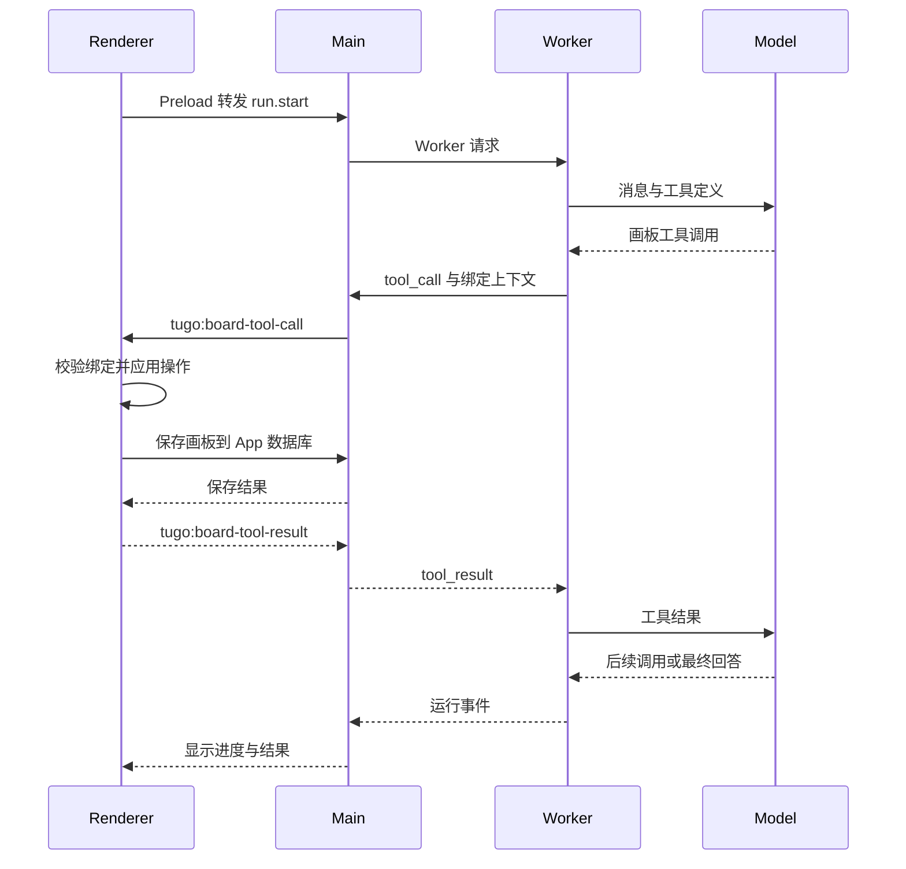

# 已归档：01 原版架构：TuGo 1.0.0

> 历史源码基线，不表示重构后的现状。现行方案见 [IMPLEMENTATION](../../IMPLEMENTATION.md)。

[架构蓝图目录](README.md) · [下一篇：SDK 化架构](02-kernel-sdk-blueprint.md)

> 类型：源码事实基线。对应提交 `0540abb`，核对日期 2026-08-31。这里的“原版”是 SDK 化之前的当前实现，不表示最早历史版本。后文的目标接口尚不存在。

## 1. 系统定位与边界

TuGo 是本地优先的 Electron AI 画布产品。React Renderer 负责画板和交互；Electron Main 托管本地数据、凭据和 IPC；Agent Runtime 在 Node Worker 中执行。模型服务和 MCP 服务可在本机之外。

当前没有独立运行的 Runtime HTTP 服务。`runtime.http` 是消息方法名，`/api/...` 是 Worker 内部路由，不应误画为对公网开放的后端 API。

### 1.1 运行单元

| 单元 | 生命周期与职责 | 代码入口 |
| --- | --- | --- |
| React Renderer | 画板、聊天、项目和设置；执行画板工具；展示流式事件 | [App.tsx](../../../../src/App.tsx)、[InfiniteCanvas.tsx](../../../../src/components/InfiniteCanvas.tsx) |
| Preload bridge | 通过 `window.tugo` 暴露 IPC，隔开 Renderer 与 Node 能力 | [preload.cjs](../../../../electron/preload.cjs) |
| Electron Main | 窗口、App 数据库、文件与凭据、Worker 管理、画板工具转发 | [main.cjs](../../../../electron/main.cjs) |
| Runtime Worker | 接收请求、运行 Agent、管理 Runtime 数据与外部工具 | [worker.ts](../../../../runtime-ts/src/worker.ts)、[runtime.ts](../../../../runtime-ts/src/runtime.ts) |
| 外部能力 | 模型请求、MCP 服务、内置 Web 搜索与抓取 | [providers.ts](../../../../runtime-ts/src/providers.ts)、[mcp.ts](../../../../runtime-ts/src/mcp.ts)、[tools.ts](../../../../runtime-ts/src/tools.ts) |

Main 与 Worker 位于同一个桌面应用中，Worker 分离不等于安全沙箱。MCP stdio 可以启动服务进程，也不等于已对其执行了操作系统级隔离。

### 1.2 一次 AI 修改画板的消息路径

这是含一次成功画板写操作的简化路径；模型可以执行多轮，流式事件会在运行中持续转发。App 和 Runtime 的保存并不是跨数据库原子事务。

## 2. 模块职责

| 模块 | 已承担职责 | 当前耦合 |
| --- | --- | --- |
| `src/api.ts` | Renderer 调用 Runtime、订阅事件、创建会话 | 依赖 `window.tugo`，线程上下文带项目和会话 ID |
| `src/App.tsx` | 项目、会话、编辑历史、自动保存、工具 bridge、配置与 UI | UI、业务服务与画板工具执行集中在同一文件 |
| `src/lib/boardState.ts` | 文档规范化、操作应用、内存撤销重做 | Canvas 领域逻辑 |
| `src/lib/exportDocument.ts` | 区域 SVG、位图、PDF、PPTX、draw.io 输出 | 与画布的渲染实现并非同一条路径 |
| `electron/app-repository.cjs` | 项目、文件夹、会话 CRUD | 使用 Main 持有的 App 数据库 |
| `electron/app-database-storage.cjs` | App 数据库落盘、备份、恢复 | 本地文件与 SQL.js |
| `electron/runtime-client.cjs` | Worker 请求响应、超时、事件和重启 | Electron 路径与应用生命周期 |
| `runtime.ts` | 执行循环、内部路由、事件、模型调用、工具调度 | 直接构造依赖，内嵌画板和 Skill 编辑业务 |
| `repository.ts` | 模型、Agent、线程、Run、Checkpoint、日志、附件、默认配置 | 存储、业务初始化、迁移、提示词和资源管理混合 |
| `tools.ts` | Schema 校验、参数修复、内置工具分派、MCP 调用 | 画板参数修复、图形质量、Web 与 Skill 操作混合 |
| `middleware.ts` | Skill 目录、计划提醒、循环检测 | 三个 Hook，代码固定装配 |
| `contracts.ts` | 模型消息、工具、事件、Checkpoint、宿主协议 | 有通用骨架，但带项目和会话字段，缺少通用授权与执行器契约 |

## 3. 数据与状态所有权

| 状态 | 当前所有者 | 持久化与恢复边界 |
| --- | --- | --- |
| 画板当前内容、撤销栈 | Renderer 的 `BoardHistory` | 当前文档保存到 App DB；内存撤销栈不等于持久化快照 |
| 项目、文件夹、产品会话、画板快照 | Main / App repository 与快照 IPC | App 数据库 `tugo.sqlite` |
| 模型、Agent、Skills、MCP、运行状态与事件 | RuntimeRepository | `runtime/runtime.sqlite`，SQL.js 快照文件 |
| 模型上下文、计划、执行边界、Middleware 状态 | Runtime Checkpoint | 可恢复历史与中断信息，不代表重启后自动继续执行 |
| 导入附件、生成图片和文件 | Runtime 资源目录 | `runtime/attachments` 与附件记录关联 |
| 主题、模型选择等配置 | Main | 本地配置文件 |
| API Key 等凭据 | Main | `runtime-secrets.json` 本地加密，向 Worker 注入秘密值；不是系统钥匙串 |
| 活跃执行器、AbortController、等待工具回包 | Worker / Main 内存 | 进程生命周期结束后不能直接恢复 |

产品会话与 Runtime 线程通过 `threadId` 关联。Main 有陈旧线程关系协调逻辑，但两个数据库没有共享事务；不能将它们视为一个天然一致的状态仓库。

现行“完整备份”只打包 App 与 Runtime 数据库，不含附件、配置和凭据，且没有全量 ZIP 一键恢复。见 [备份与恢复](../../../DATA_RECOVERY.md)。

## 4. 启动、执行与停止

### 4.1 启动

正常启动路径如下；Runtime 初始化失败时 Main 会记录错误并仍可创建窗口，不代表 AI 已就绪。

1. Main 准备配置和 App DB，注册 IPC。
2. EmbeddedRuntimeClient 创建 Worker，传入 Runtime 数据目录与默认配置路径。
3. Worker 打开 RuntimeRepository：检查数据、迁移、标记遗留运行中断、安装默认模板、清理资源并落盘。
4. Worker 注册消息监听后发送 `ready`。
5. Main 处理凭据迁移与注入、会话线程协调，再创建窗口。

`repository.open()` 不只是打开数据库，也会植入 TuGo 默认工具、Agent 和 Skill 编辑助手。这是独立 SDK 启动需要拆开的边界。

### 4.2 一轮 Run

1. 校验线程、Agent 和可选模型；清理没有活跃执行器的陈旧运行标记。
2. 根据项目范围限制同一画板的并发运行。
3. 读取最近 Checkpoint，修复中断工具消息，加入用户输入。
4. 解析工具、MCP、Skills 和模型能力；保存本次运行配置快照。
5. 按需压缩上下文，执行 `beforeModel`，请求模型，按策略重试。
6. 执行 `afterModel`；有工具时校验、记录并执行 `beforeTool` 和工具分派。
7. 处理工具结果、画板截图/PPT 等产物，再进入下一轮。
8. 模型没有进一步工具调用且无待处理补充指令时，可以完成 Run；记录事件、用量和耗时。

当前有循环次数、工具次数和运行时长配置；运行时长在循环边界检查，不应据此宣称任何挂起工具都会在同一总截止时间被强制终止。

### 4.3 中断与恢复

- 取消通过 AbortController 向下传播；工具 bridge 也有超时与错误返回。
- 工具执行记录抑制相同调用的重复执行；记录了部分不确定副作用情况。
- 应用重启后，遗留 `queued/running` Run 转为 `interrupted`，没有持久化后台调度器。
- 新一轮可沿用历史上下文及部分未完成计划，但不等同于原 Run 原位恢复。
- Renderer 丢失会使依赖 Renderer 的工具失败，并触发相关运行取消；不能承诺关掉窗口仍完成画板任务。
- Worker 可被有界重启，但重启 Worker 不等于自动恢复其正在执行的任务。

依据：[runState.ts](../../../../runtime-ts/src/runState.ts)、[runtime-client.cjs](../../../../electron/runtime-client.cjs)、[window-lifecycle.cjs](../../../../electron/window-lifecycle.cjs)。

## 5. 已有通用能力与业务耦合

### 5.1 可保留的通用基础

模型适配、流式协议、事件关联、Checkpoint、配置快照、工具执行记录、上下文预算、重试与循环限制、MCP、Skills 和追踪系统都值得保留。已有实现不应在平台化过程中被重新写一遍或弱化。

### 5.2 需要迁出的耦合点

| 编号 | 现状 | 对 SDK 化的影响 |
| --- | --- | --- |
| C1 | `systemMessages` 始终理解画板绑定；多语言 Agent soul 也有画图与禁止 Shell 语义 | 只替换提示词不能可靠切换产品 |
| C2 | `ToolRegistry` 根据工具名和 `handlerKey` 分派，画板修复写在核心文件 | 定义可配置不等于执行实现可注册 |
| C3 | Runtime 对 `board_capture_image`、`board_export_pptx`、质量审计有特殊分支 | 新产品成果容易继续侵入主循环 |
| C4 | Repository 打开和 bootstrap 时修复 TuGo 固定工具与 Agent 绑定 | 单纯移到 npm 包仍带有隐式产品初始化 |
| C5 | 画板写工具要经 Renderer 执行，再保存 App DB | 无界面宿主不能直接复用这套画图工具 |
| C6 | Middleware 只有三个 Hook，并可直接操作可变 Checkpoint | 缺少明确的结果、结束、错误扩展和状态隔离契约 |
| C7 | 工具副作用部分按 `board_` 前缀或 MCP 来源判断 | 不足以覆盖读文件、改文件、运行命令等不同风险 |
| C8 | 生命周期与桌面窗口、单机 Worker 绑定 | 长任务、审批等待和后台运行需增加明确策略 |

依据：[localizedPrompts.ts](../../../../runtime-ts/src/localizedPrompts.ts)、[tools.ts](../../../../runtime-ts/src/tools.ts)、[middleware.ts](../../../../runtime-ts/src/middleware.ts)、[repository.ts](../../../../runtime-ts/src/repository.ts)。

## 6. 测试与证据边界

已有测试覆盖 Provider、Runtime、工具、MCP、Repository、状态机、Renderer 纯逻辑等；桌面脚本覆盖启动、保存、恢复和部分交互。另有视觉导出、规模与长时间运行脚本。

- [quality.yml](../../../../.github/workflows/quality.yml) 执行源码门禁和 macOS 桌面测试，没有纳入全部视觉、规模、长时间运行与打包态测试。
- [electron-e2e.mjs](../../../../scripts/electron-e2e.mjs) 使用模拟模型服务，不能证明真实模型的出图成功率。
- [runtime.test.ts](../../../../runtime-ts/tests/runtime.test.ts) 能直接实例化 Runtime，证明核心不必由真实 Electron 窗口启动；不证明画板工具已无界面化。
- 本轮只整理架构文档，未重新执行产品全量测试。此前本地测试与完整构建被缺失的 Rollup 原生依赖阻断，不能写成当前全量测试通过。

## 7. 现状结论

当前架构是“已有通用执行基础的画图产品 Runtime”。SDK 化主要工作是依赖反转、产品规则迁出、扩展生命周期和安全/恢复契约，而不是重写模型循环。目标分层和现状映射见 [02](02-kernel-sdk-blueprint.md)。
