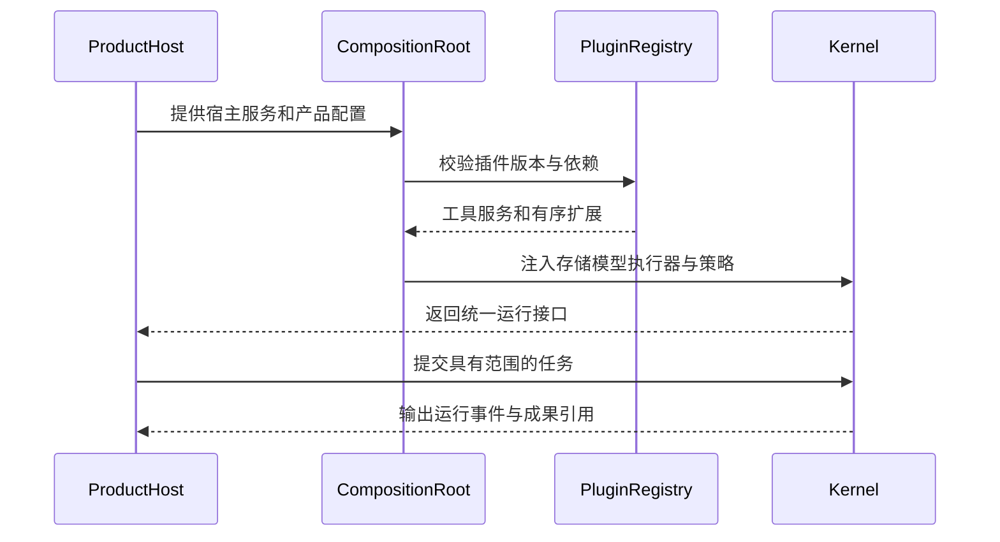
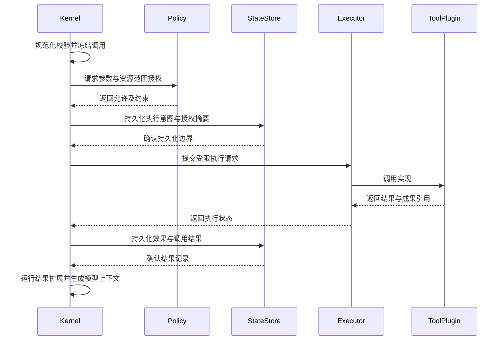

# 已归档：02 SDK 化架构：Agent Kernel SDK

> 讨论稿已由 [三部分实施方案](../../IMPLEMENTATION.md) 替代，不作为当前实施指令。

[架构蓝图目录](README.md) · [原版架构](01-current-architecture.md) · [迁移与验收](03-migration-and-validation.md)

> 类型：目标设计提案 v0.1，不是现有 API。以下包名、类型和阶段均为草案；关键开放问题必须经过评审和实验，才能进入可实施定稿。

## 1. 目标与首版范围

产品由通用 Kernel、功能插件、宿主适配和产品壳组合。审计、记忆等横切能力可在多个产品复用；Canvas、coding、research 的领域工具和数据模型不进入核心。

### 1.1 建议的 SDK v0 范围

- Node.js / TypeScript，内部使用，第一方可信插件。
- 启动时静态组装，在同一仓库中开发和锁定版本；暂不承诺对外发布稳定 SDK。
- 单机执行，默认串行模型循环与串行工具执行；保留以后扩展空间，不预做多 Agent 编排。
- Electron Host 保持 TuGo 产品可用，Node Host 运行非画图验证场景。
- 保留现有 Provider、SQL.js 和已验证运行能力，通过接口适配，避免同时更换技术栈。
- 插件配置和版本对一个 Run 固定；新 Run 才使用新配置。

### 1.2 首版不做

插件市场、任意第三方插件、运行中热插拔、多租户服务、分布式执行、全自动跨机恢复，以及完整 coding/research 产品。通用权限接口不等于已经实现安全沙箱；通用存储接口不等于已经实现云数据库。

## 2. 概念与职责

| 概念 | 定义 | 示例 |
| --- | --- | --- |
| Kernel | 持有运行状态机与执行协议，协调能力，不理解业务实体 | Run、工具调用生命周期、事件、预算 |
| Plugin | 可安装和版本化的能力交付单元，可贡献多种扩展 | Canvas、Memory、Audit、MCP |
| Middleware | 插件接入生命周期的一种机制，不是万能组件容器 | 上下文注入、模型结果检查、观测 |
| Service / Port | 稳定功能接口；实现可以由插件或宿主提供 | StateStore、ArtifactStore、Policy、Executor |
| Host | 提供进程、文件、凭据、通信和实际执行边界 | Electron、无界面 Node |
| Product Profile | 声明产品默认插件、工具、Skills、提示词和策略 | Canvas 配置、Coding 验证配置 |
| Product Shell | 用户交互与业务状态展示，消费统一事件 | 画板、代码差异、来源与报告界面 |

Plugin 是包装单位，Middleware 是扩展方式。沙箱执行器不应伪装成任意修改工具参数的 Hook；记忆可以是存储服务加上下文贡献者；审计应输出可解释的检查结果。

## 3. 装配与运行视图



这是逻辑装配关系，不代表四个独立服务。Node Host 可在进程内实例化 Kernel；Electron Host 可以在 Worker 内组装 Kernel，函数实现不通过 IPC 传递，只传可序列化的配置、请求和结果。

### 3.1 代码依赖约束

| 模块 | 允许依赖 | 禁止依赖 |
| --- | --- | --- |
| Contracts | 类型、协议与最少量校验定义 | React、Electron、Canvas、具体数据库 |
| Kernel | Contracts 与纯运行逻辑 | 产品代码、插件实现、Electron、具体存储实现 |
| 通用插件与 Adapter | Contracts；必要的基础库 | 产品 UI、其他插件的私有实现 |
| Canvas Plugin | Contracts、Canvas 领域库 | 整个 React App 的可变内部状态 |
| Host / Composition Root | Kernel、插件实现、Adapter | 不得绕开 Kernel 执行受控工具 |
| Product Shell | 产品 API、事件与 UI 适配 | 直接修改核心 Checkpoint、调用未授权执行器 |

Kernel 不创建 `new RuntimeRepository()` 或通过产品名分支选能力。Composition Root 负责选用具体实现。UI 与 Kernel 可共享类型，不共享可变运行对象。

### 3.2 建议目录，仅在迁移阶段创建

| 候选目录 | 初期内容 |
| --- | --- |
| `packages/agent-contracts` | 插件、工具、事件、运行、状态、授权协议 |
| `packages/agent-kernel` | 循环、状态转换、调度、预算、核心安全约束 |
| `packages/agent-adapters` | 当前 Provider、SQL.js、附件存储适配 |
| `packages/agent-plugins` | Plan、Skills、MCP、Audit 等首批实现 |
| `packages/canvas-agent` | Canvas 工具、上下文、提示词、质量与成果处理 |
| `hosts/node` | 无界面参考宿主和集成验证 |
| 现有 `electron/`、`src/` | 渐进接入 SDK；不必先搬动整个 TuGo UI |

这些是候选源码边界，不要求每个目录立即成为独立 npm 包；公开包数量由依赖图和真实消费方式决定。

## 4. 扩展契约草案

以下只表达边界，不是可复制运行的完整 TypeScript SDK。接口异常、序列化和兼容规则在 D1–D6 关闭后定稿。

```ts
interface PluginManifest {
  id: string;
  version: string;
  kernelApi: string;
  dependencies: Record<string, string>;
  requestedCapabilities: string[];
  stateSchemaVersion?: number;
}

interface Plugin {
  manifest: PluginManifest;
  setup(registrar: Registrar): void;
  start?(context: PluginServices): Promise<void>;
  stop?(): Promise<void>;
}

interface Registrar {
  tool(definition: ToolDefinition): void;
  middleware(definition: MiddlewareDefinition): void;
  contextSource(definition: ContextSource): void;
  check(definition: CompletionCheck): void;
  service(definition: ServiceBinding): void;
}
```

### 4.1 插件装配

1. 读取 manifest，检查 API 版本、必需依赖和配置 Schema。
2. 按依赖排序；缺失依赖、循环依赖、重复工具名或独占服务冲突则启动失败。
3. `setup` 只注册声明，不调用模型或执行业务写操作。
4. Host 审核请求的能力，创建最小服务集合；声明权限不等于已获授权。
5. 开始插件生命周期；启动失败按逆序释放已经启动的组件。
6. 冻结注册表与装配摘要；运行中不卸载或替换插件。

StateStore、Policy 和默认 Executor 等服务槽位需要明确唯一实现。多个记忆源或审计器可以并存，但顺序与聚合规则必须显式；不允许用插件安装顺序隐式覆盖安全策略。

### 4.2 工具契约

| 字段/能力 | 作用 |
| --- | --- |
| 名称、版本、输入和结果 Schema | 可发现、可校验、可兼容 |
| 执行器引用 | 在进程内、Host bridge 或隔离进程执行 |
| 效果描述 | 只读、写资源、启动进程、外部写入；允许一个工具有多种效果 |
| 资源范围解析 | 由可信解析器从实际参数得出路径、URL、画板等目标，不只信任模型描述 |
| 超时与取消 | 明确请求取消、确认停止和无法确认三种情况 |
| 重试与核查策略 | 区分安全重试、需要幂等键、只能查询结果、禁止自动重试 |
| 进度与成果 | 返回结构化进度、数据和成果引用，不把所有内容拼入一段文本 |

Kernel 统一校验与授权，领域参数兼容修复由工具自己的规范化器提供。规范化后的最终参数才进入授权；授权后再改变目标或参数必须重新校验和授权。

### 4.3 Middleware 与结果语义

候选扩展阶段：`beforeRun`、`assembleContext`、`beforeModel`、`afterModel`、`beforeTool`、`afterTool`、`beforeComplete`、`onError`、`afterRun`。

这些不是允许任意修改核心状态的回调。建议约束：

- 输入以只读快照为主，返回类型化贡献或决策，由 Kernel 校验应用。
- 上下文贡献、完成检查、观测使用不同结果类型，不定义一个万能可变对象。
- 明确阶段及同阶段顺序；跨阶段不能通过优先级重新排序。
- 所有扩展有时间和资源预算，并接收取消信号。
- 授权/必须的验收失败默认阻断；非必要观测失败可降级，但必须记录。
- `afterTool` 失败不能抹掉已经记录的工具效果，也不能因此重跑写操作。
- `afterRun` 只能清理与观测，不能把失败 Run 改为成功或新增业务操作。
- 记忆写入应是可追踪操作，不通过结束 Hook 偷偷产生不可恢复副作用。

完整阶段顺序、返回类型与错误表属于 D2 的必需产物；原型阶段只实现第二场景真正需要的扩展点。

## 5. 运行、权限与副作用

### 5.1 核心不变量

1. 未注册或未授权的工具不能执行。
2. Plugin 与模型都不能直接设置 Run 为成功，终态由 Kernel 产生。
3. 结果不确定不等于失败，也不等于可以再次执行。
4. 关键记录无法持久化时，不应继续启动新的有副作用操作。
5. 安全和资源范围由 Host 约束，不能仅靠系统提示词。
6. 对外部工具不承诺通用 exactly-once；需要幂等协议或效果核查。

### 5.2 受控工具的成功路径



拒绝、审批、超时和结果落盘失败不包含在成功路径内，必须按下表处理，不能把异常路径画成成功回包。

| 情况 | 建议行为 |
| --- | --- |
| 未获授权 | 不执行；持久化可解释的拒绝结果 |
| 需要审批 | 保存最终参数摘要、范围、请求 ID 和有效期；等待明确决定 |
| 审批后资源变化 | 重新检查文件版本、目标范围等前置条件，必要时重新审批 |
| 结果超时或进程失联 | 记录不确定；先查询执行器或目标状态，不能默认重试 |
| 请求取消 | 停止调度新工具，要求执行器确认；无法确认时保留不确定标记 |
| 工具已执行但记录失败 | 进入恢复核查流程，不向模型虚构成功或安全失败 |
| 仅后处理失败 | 保留原工具效果记录，修复/重试后处理，不重放工具 |

### 5.3 信任边界

首版插件在可信 Node 环境中运行。受限接口帮助控制依赖，但不是操作系统安全隔离；恶意同进程插件仍可能直接访问 Node API。

沙箱插件实现工具执行隔离，并不自动隔离插件代码自身。支持不可信插件前必须另行确定进程边界、文件/网络/进程权限、IPC 校验和资源限制。Worker 本身不承担这个保证。

首版 coding 验证优先采用隔离测试目录、只读默认和待确认补丁；没有可靠执行边界时，不因架构图已有 Executor 就开放任意 Shell。

## 6. 状态、恢复与成果

### 6.1 状态所有权

| 状态 | 所有者 | 约束 |
| --- | --- | --- |
| Run、调用账本、授权记录、事件游标 | Kernel，经 StateStore 持久化 | 单一写入协议，不向插件暴露原始数据库 |
| 记忆索引、审计结果等扩展状态 | 对应插件，经受限状态接口访问 | 产品/工作区/插件命名空间，记录 Schema 版本 |
| 画板、仓库文件、研究证据模型 | 领域服务 | Kernel 只持有资源引用与版本，不统一业务 Schema |
| 图片、补丁、报告、较大工具输出 | ArtifactStore 与领域元数据 | 明确 MIME、来源、范围、保留策略和可见性 |
| 凭据 | Host 的 SecretProvider | 不写入提示词、插件配置快照、日志或 Checkpoint |
| UI 当前选区、面板状态 | Product Shell | 不作为后台执行唯一事实来源 |

共用插件不等于共用数据。跨产品记忆共享必须显式配置，并与工作区授权一起校验。

### 6.2 版本和恢复

Run 装配快照建议记录 Kernel、插件及配置版本、工具 Schema 指纹、提示词与 Skill 版本、模型配置摘要、状态 Schema 和资源范围。已有运行配置快照是迁移基础，不需要另起一套无关联记录。

分两步建设恢复：

- **SDK v0**：保留当前中断语义，支持读取历史和明确发起后续 Run；不冒充原 Run 原位续跑。
- **后续恢复阶段**：引入持久化等待/暂停、执行器状态查询和调用核查；恢复前检查插件版本、授权有效期、资源版本和未决副作用。

候选新增状态包括 `waiting_approval`、`paused`、`recovery_required`；名称与完整转换表尚待 D4 定稿。旧 `interrupted` Run 不应未经迁移直接当作可恢复状态。

### 6.3 成果和完成检查

工具结果区分供模型读取的摘要、结构化数据与成果引用。大输出应存为资源再按需读取，避免通用字符串截断破坏证据或补丁。

审计框架输出 `pass / warn / block`、问题列表、审计器版本和被审计资源版本。产品 Profile 决定哪些检查必需；Kernel 执行这个决定，不负责判断图是否美观或代码是否正确。

被审计资源变化后旧结果失效。检查轮数耗尽时应输出未完成或带警告的真实结果，不能通过删除阻断项获得“成功”。

## 7. 三种产品如何组装

| 组成 | Canvas | Coding 最小场景 | Research 最小场景 |
| --- | --- | --- | --- |
| 共用能力 | 模型、循环、事件、状态、Skills、预算、策略接口 | 同左 | 同左 |
| 领域工具 | 查改画板、布局、截图、导出 | 搜索/读取文件、生成补丁、受控应用、测试 | 检索、读取来源、保存摘录、维护证据、报告 |
| 上下文来源 | 选区、元素关系、图形 Brief | 工作区、文件版本、差异、测试结果 | 问题范围、来源与引用、待核查声明 |
| 审计规则 | 内容覆盖、图形几何、导出 | 修改范围、补丁冲突、测试 | 证据可追溯、覆盖与不确定性 |
| UI | 画布与聊天 | 文件、差异与终端结果 | 来源列表、证据与报告 |
| 主要执行约束 | 画板绑定与选区/锁定规则 | 路径、命令、进程、网络与授权 | 来源信任、网络访问、资料与记忆范围 |

这张表描述候选组合，不承诺已有这些产品。MCP 只是工具来源之一，不能替代完整 Plugin 生命周期，也不能自动解决领域质量问题。

## 8. 原版到目标的迁移映射

| 原版职责 | 目标归属 | 保留原则 |
| --- | --- | --- |
| 模型循环、用量、事件、调用记录 | Kernel | 优先移动后适配，保留现有回归 |
| Provider 实现 | Adapter | 不同时切换协议实现 |
| SQL.js、附件文件管理 | StateStore / ArtifactStore Adapter | 第一阶段保留物理存储与旧数据 |
| 默认工具和 Agent seed | Product installer / Profile | 与打开核心数据库分开；不得覆盖用户编辑 |
| board 参数修复、绑定与 bridge | Canvas Plugin / Canvas Host port | 保留范围校验，不能因“通用化”删除保护 |
| 图形质量与审查轮数 | Diagram Audit Plugin | 与真实资源版本关联，规则不进入核心 |
| 截图、PPT 结果特殊分支 | Canvas 工具结果与 ArtifactStore | 复用统一成果协议 |
| Plan、Skills、MCP | 第一方插件 | 保留原有能力与追踪 |
| 内置 Web 搜索和抓取 | Web 工具插件 | 保留现有网络限制，不默认扩权 |
| Skill 编辑助手 | 独立编辑能力包或管理服务 | 不让所有产品启动时强制创建该 Agent |
| Electron Worker RPC | Electron Host / 兼容 facade | 迁移期维持旧 UI 消息协议 |
| React 产品 UI | TuGo Shell | 不要求先重构完整 UI 才能抽离核心 |

## 9. 定稿前必须回答的问题

Plugin 生命周期与注册冲突（D1）、Middleware 语义（D2）、授权和执行器（D3）、恢复状态机（D4）、存储及迁移（D5）、事件与成果协议（D6）、Canvas 权威状态（D7）、第二验证场景与范围（D8）均在 [03 决策登记表](03-migration-and-validation.md) 跟踪。

本蓝图可作为实验与深入设计的输入，但在关键决策未关闭前，不应直接作为对外稳定 API 或生产安全承诺。
